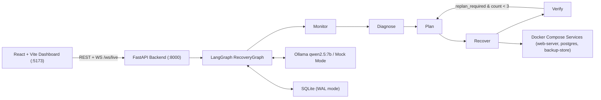

# ResilienceAI

> Multi-agent AI digital disaster recovery simulator built with LangGraph, FastAPI, Ollama (`qwen2.5:7b`), Docker Compose, and React.

## What It Does

ResilienceAI simulates infrastructure failures in isolated Docker services (`web-server`, `app-database`, `backup-store`) and coordinates five specialized agents in a stateful LangGraph pipeline:

1. **Monitor Agent** — probes service health endpoints and identifies affected services.
2. **Diagnose Agent** — classifies root cause and severity using constrained JSON output.
3. **Plan Agent** — selects a validated remediation playbook from the strategy catalog (and picks alternatives on replan).
4. **Recover Agent** — executes deterministic Docker restart or backup restoration tools.
5. **Verify Agent** — re-checks post-recovery health and triggers up to 3 replan loops if recovery failed.

All agent transitions stream live over WebSocket (`/ws/live`) to a React dashboard showing pipeline progress, MTTR breakdown charts, and incident history.

## Architecture



See [docs/architecture.md](docs/architecture.md) for component boundaries and state contracts.

## Quickstart

### Option 1: Mock Mode (Recommended for Quick Demo — No Docker or Ollama Needed)

```powershell
# Backend (from repo root)
.\.venv\Scripts\python.exe -m uvicorn backend.api.main:app --reload --port 8000

# Frontend (in a second terminal)
cd frontend
pnpm dev
```

Open **http://localhost:5173**, select **Server Crash**, and click **Trigger Disaster**.

### Option 2: Full Docker Compose Stack

```bash
cp backend/.env.example backend/.env
docker compose up --build
```

For real LLM inference, ensure Ollama is running with `qwen2.5:7b` (`ollama pull qwen2.5:7b`) and set `MOCK_MODE=false` in `backend/.env`. See [docs/running-locally.md](docs/running-locally.md) for full details.

## Tech Stack

| Layer | Technology |
|---|---|
| Agent Orchestration | LangGraph (`StateGraph` + `MemorySaver`) |
| LLM Inference | Ollama (`qwen2.5:7b`) / deterministic `MOCK_MODE` |
| Backend API | FastAPI + Uvicorn + WebSockets |
| Persistence | SQLite (WAL mode) |
| Infrastructure Target | Docker Compose (`nginx:alpine`, `postgres:15-alpine`, `alpine`) |
| Frontend | React 18 + TypeScript + Vite 6 + Tailwind v4 + Zustand + Recharts |
| Testing | `pytest` (backend) + `vitest` (frontend) |

## Running Tests

```powershell
# Backend (30+ tests in MOCK_MODE)
.\.venv\Scripts\python.exe -m pytest backend/tests/ -v

# Frontend
cd frontend
pnpm test --run
```

## Documentation

- [Running Locally Guide](docs/running-locally.md)
- [Architecture Overview](docs/architecture.md)
- [Implementation Plan](docs/plans/resilience-ai-plan.md)
- [Tech Stack Decisions](docs/product/tech-stack.md)
