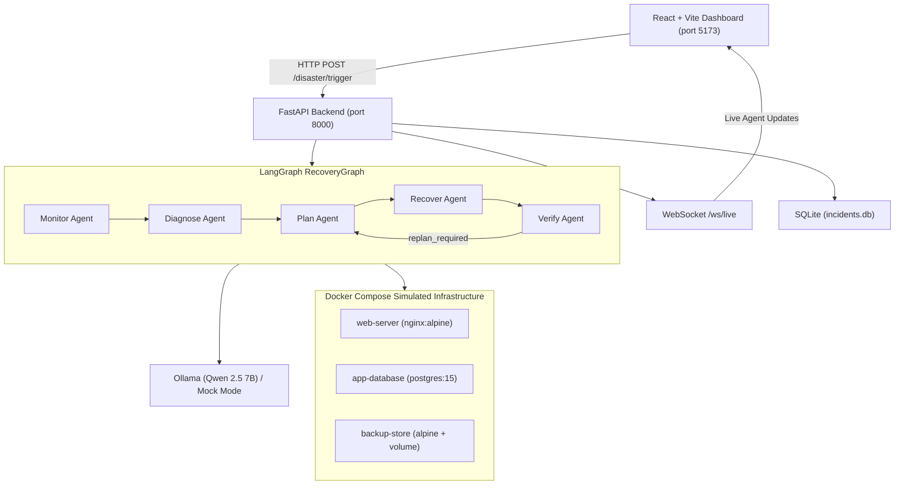

# ResilienceAI Architecture

## System Overview

## Component Boundaries

| Component | Responsibility | Does NOT own |
| :--- | :--- | :--- |
| Docker Compose infra | Run simulated services; accept stop/start commands | Disaster logic, agent logic |
| Disaster Simulator | Inject failures via Docker API | Recovery logic |
| LangGraph pipeline | Orchestrate agent execution and state transitions | UI, HTTP routing, DB writes |
| Agents | Perform one step each and return partial `RecoveryState` | Calling the next agent directly |
| FastAPI backend | HTTP routing, WebSocket broadcast, DB persistence | Agent logic, UI rendering |
| React dashboard | Render state and send trigger commands | Business logic |
| SQLite | Persist incident logs, agent actions, and metrics | Nothing else |
